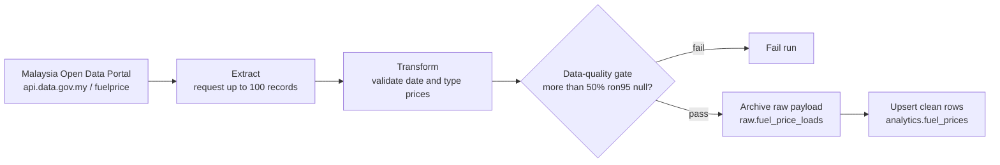

# Fuel Price ETL Pipeline

A containerized, scheduled **extract–transform–load (ETL) pipeline** for Malaysian fuel-price data. It retrieves weekly records from Malaysia's public data API, validates and types source fields, archives each raw response, and upserts clean rows into PostgreSQL. Apache Airflow coordinates the workflow, retries transient failures, and blocks loads when a basic data-quality check indicates a broken source batch.

## Value proposition

This project demonstrates practical data-engineering concerns beyond a single transformation script: separation between orchestration and business logic, raw-data retention for auditability, idempotent warehouse loading, environment-based configuration, containerized local infrastructure, and unit tests for extraction, transformation, and loading behavior.

## Overview

The pipeline uses the `fuelprice` dataset from Malaysia's Open Data Portal at `api.data.gov.my`. The extractor requests up to 100 records without an API key. The transformer converts dates and price values into typed Python values while skipping invalid rows. The loader writes the untouched response to an append-only raw table and upserts cleaned records into an analytics table keyed by `price_date`.

The Airflow DAG is named `fuel_price_etl`. It runs Fridays at 06:00 (`0 6 * * 5`), starts on 2026-01-01, and does not catch up missed runs. Each task may retry three times with a five-minute delay.

## Workflow



The extract task refuses an empty API response. The transform task fails if no rows survive validation. The data-quality task fails when more than half of the cleaned rows have a missing `ron95` value. Loading happens only after that gate passes.

## Features

- **Separated ETL stages:** `src/extract`, `src/transform`, and `src/load` keep API access, pure data cleaning, and database writes independent.
- **Raw audit trail:** every API response is stored as JSONB in `raw.fuel_price_loads` with its source URL and generated load identifier.
- **Typed analytics table:** cleaned records are stored in `analytics.fuel_prices` with `price_date`, `ron95`, `ron97`, `diesel`, and `diesel_eastmsia` columns.
- **Retry-safe loading:** `price_date` is unique and the loader uses PostgreSQL `ON CONFLICT` upserts, so reprocessing a date updates the existing row instead of creating a duplicate.
- **Basic data-quality protection:** empty responses, batches with no valid rows, and batches with excessive missing `ron95` values are rejected.
- **Local reproducibility:** Docker Compose provisions Airflow's metadata database, a separate PostgreSQL warehouse, the Airflow initializer, webserver, and scheduler.
- **Unit-tested boundaries:** tests cover request construction and response validation, record cleaning, bad-row handling, raw-payload archiving, upsert behavior, and empty-batch behavior.

## Tech stack

| Area | Technology | Evidence in repository |
| --- | --- | --- |
| Orchestration | Apache Airflow 2.9.3, LocalExecutor | `Dockerfile`, `docker-compose.yml`, `dags/etl_pipeline_dag.py` |
| Application code | Python | `src/`, `dags/`, `requirements.txt` |
| Source access | `requests` 2.32.3 | `src/extract/api_client.py`, `requirements.txt` |
| Warehouse access | PostgreSQL 16 and `psycopg2-binary` 2.9.9 | `docker-compose.yml`, `sql/schema.sql`, `src/load/loader.py` |
| Configuration | `python-dotenv` 1.0.1 and environment variables | `requirements.txt`, `.env.example`, `src/config.py` |
| Testing | `pytest` 8.3.2 | `tests/`, `requirements.txt` |
| Runtime | Docker and Docker Compose | `Dockerfile`, `docker-compose.yml` |

## Repository structure

```text
dags/etl_pipeline_dag.py    Airflow DAG and task dependencies
src/config.py               API and warehouse configuration
src/extract/api_client.py   API URL construction and raw extraction
src/transform/cleaner.py    Date parsing, numeric conversion, and row validation
src/load/loader.py          Raw-payload inserts and analytics upserts
sql/schema.sql              Raw and analytics PostgreSQL schemas
tests/test_extract.py       Extract-stage unit tests
tests/test_transform.py     Transform-stage unit tests
tests/test_load.py          Load-stage unit tests
Dockerfile                  Airflow image with pinned project dependencies
docker-compose.yml          Local Airflow and PostgreSQL services
.env.example                Required local environment variables
requirements.txt            Pinned Python dependencies
```

## Setup and usage

### Prerequisites

Install Docker with Docker Compose support. The repository is designed to run the pipeline through Compose rather than as a standalone local Python process.

### Start the stack

From the repository root:

```bash
cp .env.example .env
```

Set a non-default `WAREHOUSE_DB_PASSWORD` and `AIRFLOW_ADMIN_PASSWORD` in `.env` before starting. Then run:

```bash
docker compose up -d
```

The first startup builds the Airflow image, migrates Airflow's metadata database, creates the configured admin user, and starts the scheduler and webserver after both PostgreSQL services are healthy.

Open the Airflow UI at [http://localhost:8080](http://localhost:8080), sign in with the credentials from `.env`, enable the `fuel_price_etl` DAG, and trigger it manually. If left enabled, it runs Fridays at 06:00. The warehouse PostgreSQL service is exposed on host port `5433` for inspection with `psql`, DBeaver, or another PostgreSQL client using the `.env` warehouse credentials.

For a clean shutdown:

```bash
docker compose down
```

The Compose file defines named volumes for Airflow metadata, warehouse data, and logs. Removing volumes is destructive because it deletes the persisted local databases.

### Run the unit tests

The test suite is intended to run with the pinned requirements installed:

```bash
python -m pip install -r requirements.txt
pytest
```

The tests mock HTTP and database boundaries, so they do not constitute live API or end-to-end warehouse verification.

## Data model and loading behavior

The initialization script creates two schemas. `raw.fuel_price_loads` stores one immutable JSONB payload per pipeline load. `analytics.fuel_prices` stores one typed row per unique `price_date`, with a foreign-key reference to the raw load that produced it. The API payload is passed to the raw table before cleaned rows are upserted into the analytics table.

The current implementation handles `ron95`, `ron97`, `diesel`, and `diesel_eastmsia`. Missing numeric values become `NULL`; records without a usable `date` are skipped by batch cleaning. The repository does not include a sample output extract, dashboard, benchmark, or recorded production run.

## Current status and results

The repository contains an implemented Airflow DAG, Docker-based local runtime, PostgreSQL schema, ETL modules, and unit tests. The checked-in tests exercise the core stage boundaries, but no test output or live API/warehouse results are recorded. This README therefore describes implemented behavior rather than claiming measured throughput, accuracy, or a successful production deployment.

## Future improvements

The existing project notes identify three extensions: add MET Malaysia weather data as a second source, add a dbt layer for derived metrics such as week-over-week change and moving averages, and replace LocalExecutor with CeleryExecutor if the number of DAGs grows. Further production hardening could include disposable-PostgreSQL integration tests, stronger schema and freshness checks, external secret management, and monitoring or alerting for failed DAG runs.

## License

No license file is present in the repository. Consult the repository owner before reusing the code.

[1]: https://github.com/Anas-S-Muhammed/End_to_End_ETL_pipeline "End-to-End ETL Pipeline repository"
[2]: https://www.data.gov.my/data-catalogue "Malaysia Open Data Portal data catalogue"
